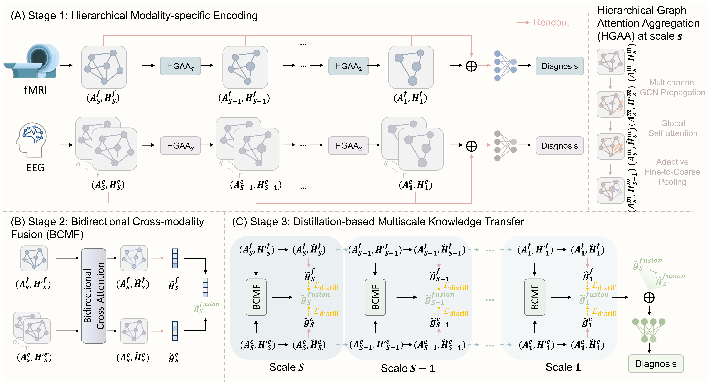

# CMD-AD: Cross-Modality Distillation from fMRI-EEG for Single-Modality Alzheimer's Diagnosis

CMD-AD is a hierarchical multi-modal distillation framework for Alzheimer's Disease (AD) diagnosis that combines functional Magnetic Resonance Imaging (fMRI) and Electroencephalography (EEG) data.

## Key Features

- **Hierarchical Graph Attention Architecture (HGAA)**: Processes brain connectivity networks at multiple ROI scales (100-500 ROIs) with fine-to-coarse pooling
- **Bidirectional Cross-Modal Fusion (BCMF)**: Scale-wise bidirectional cross-attention mechanism for effective cross-modal integration
- **Three-Stage Progressive Training**:
  - **Stage 1**: Hierarchical modality-specific encoding (independent fMRI/EEG training)
  - **Stage 2**: Bidirectional cross-modality fusion (BCMF, paired data only)
  - **Stage 3**: Distillation-based multiscale knowledge transfer (freeze fusion, distill single-modal to fused teacher)
- **Scale-wise Graph Embeddings**: Fixed-dimension graph-level representations `[B, d]` for each scale, derived from node-level features via global average pooling
- **Missing Modality Handling**: Seamlessly handles fMRI-only, EEG-only, and paired samples
- **5-Fold Cross-Validation**: Subject-level strict separation for reliable evaluation

## Framework Overview



The framework consists of three progressive training stages:

### (A) Stage 1: Hierarchical Modality-specific Encoding
Each modality (fMRI and EEG) is independently encoded using Hierarchical Graph Attention Aggregation (HGAA) across multiple scales (s ∈ {1, 2, ..., 5}). 

- **Input**: Multi-scale connectivity matrices where ROI count varies by scale (100, 200, 300, 400, 500 nodes)
- **Architecture**: 
  - **Multichannel GCN Propagation** (right side): Processes multi-frequency EEG bands
  - **Band-preserving Global Self-attention**: Captures long-range dependencies while preserving frequency band structure
  - **Adaptive Fine-to-Coarse Pooling**: Hierarchically aggregates information across scales
- **Output**: Graph-level embeddings `(A_s^f, H_s^f)` for fMRI and `(A_s^e, H_s^e)` for EEG at each scale s

### (B) Stage 2: Bidirectional Cross-modality Fusion (BCMF)
Loads pre-trained encoders from Stage 1 and trains the fusion module on paired samples.

- **Distillation losses** ensure modality-specific features are compatible
- **Cross-attention mechanism**: Bidirectional information exchange between fMRI and EEG features
- **Scale-wise fusion**: Integrates features at each hierarchical scale before final readout
- **Output**: Fused representations that combine complementary information from both modalities

### (C) Stage 3: Distillation-based Multiscale Knowledge Transfer
Freezes the fusion module (teacher) and fine-tunes single-modal encoders (students) with distillation loss.

- **Teacher**: Frozen Stage 2 fusion; **Students**: single-modal encoders.
- **Objective**: Preserve modality discriminability with supervised CE and distill teacher knowledge. Per modality *m* ∈ {fMRI, EEG}:
  - \(\mathcal{L}^m_{\mathrm{cls}} = \mathrm{CE}(\hat{y}^m, y)\)
  - \(\mathcal{L}^m_{\mathrm{distill}} = \eta\,\mathcal{L}^m_{\mathrm{feat}} + \kappa\,\mathcal{L}^m_{\mathrm{KD}}\) (feature + logit distillation)
- **Stage-3 loss**: \(\mathcal{L}_3 = \sum_{m} \big( \mathcal{L}^m_{\mathrm{cls}} + \mathcal{L}^m_{\mathrm{distill}} \big)\), with \(\eta\), \(\kappa\) controlling feature vs. logit contribution.
- **Inference**: Teacher fusion branch is discarded; only the distilled student encoder is used to predict \(\hat{y}^m\) from the available modality.

## Installation

```bash
pip install torch numpy pandas scipy scikit-learn pyyaml tensorboard tqdm
```

## Data Preparation

### CSV Format
Required columns: `sub_id`, `eeg_dst`, `fmri_dst`, `diagnosis_cat`, `diagnosis_code`

### Directory Structure
```
Data/Data_all_AD/New-split/Splits_cv5/
├── fold0/
│   ├── train_eeg_only.csv      # EEG-only training samples
│   ├── train_fmri_only.csv     # fMRI-only training samples
│   ├── train_pair.csv          # Paired training samples (Stage 2)
│   ├── train_all.csv           # All training samples (Stage 3)
│   ├── val_eeg_only.csv
│   ├── val_fmri_only.csv
│   ├── val_pair.csv
│   └── val_all.csv
└── fold1-4/  # Similar structure
```

## Training

### Stage 1: Single-Modal Warmup
Train fMRI and EEG encoders independently:
```bash
python Training_stage1.py --config configs/config_stage1.yaml --save_path results/Stage1
```

### Stage 2: Fusion Warmup
Load Stage 1 checkpoints and train all modules together (encoders + fusion, paired data only):
```bash
python Training_stage2.py --config configs/config_stage2.yaml --save_path results/Stage2
```

### Stage 3: Multiscale Distillation
Load Stage 2 checkpoint as teacher, train student encoders with distillation loss:
```bash
python Training_stage3.py --config configs/config_stage3.yaml --save_path results/Stage3
```

## Configuration

Key parameters in `configs/config_*.yaml`:
- `embed_dim`: Hidden dimension `d` (default: 64, must match across all stages)
- `use_msre`: Enable Modality-Specific Reliability Estimator (optional)
- `use_corr_align`: Enable correlation distillation before fusion (optional)
- `fusion_mode`: `"bcmf"`, `"learnable_mix"`, or `"concat_only"`
- `freeze_fusion`: Freeze fusion module in Stage 3 (default: true); only single-modal branches are trained.
- `eta`, `kappa`: Stage 3 distillation weights (feature-level and logit-level). \(\mathcal{L}^m_{\mathrm{distill}} = \eta\,\mathcal{L}^m_{\mathrm{feat}} + \kappa\,\mathcal{L}^m_{\mathrm{KD}}\). Supports warmup (e.g. `eta_ramp_epochs`).

## Results

Results are saved in `results/Stage*/` with:
- Models per fold: `model/model_*_fold{fold}.pth`
- Training logs and metrics
- TensorBoard summaries

### Metrics
- Accuracy (ACC)
- Balanced Accuracy
- Macro F1-Score
- AUC-ROC
- Sensitivity (SEN)
- Specificity (SPE)
- Confusion matrices

### Visualization
```bash
tensorboard --logdir results/Stage1/tb
```
